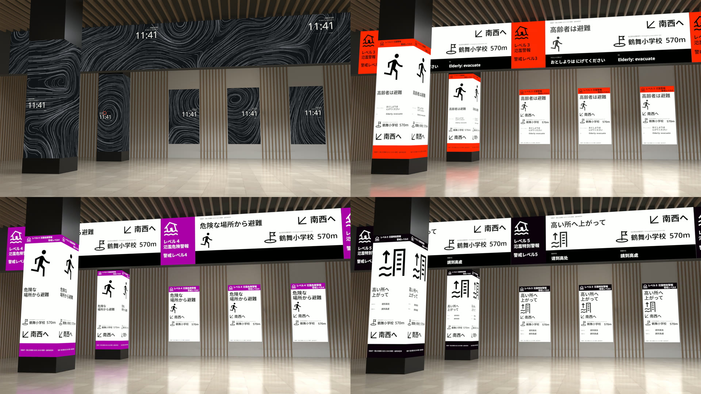
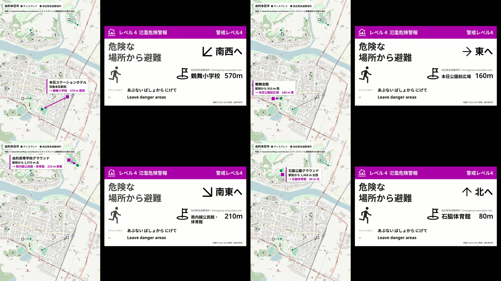
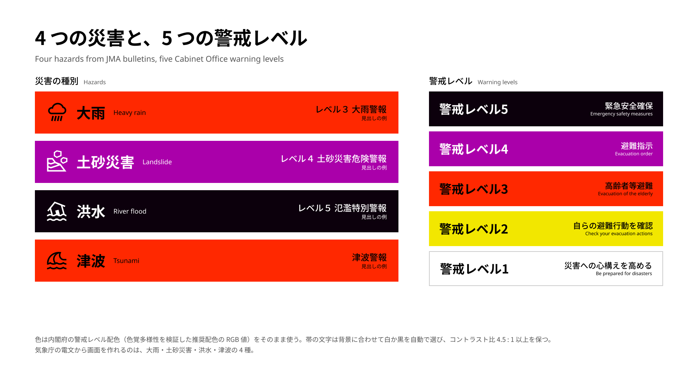
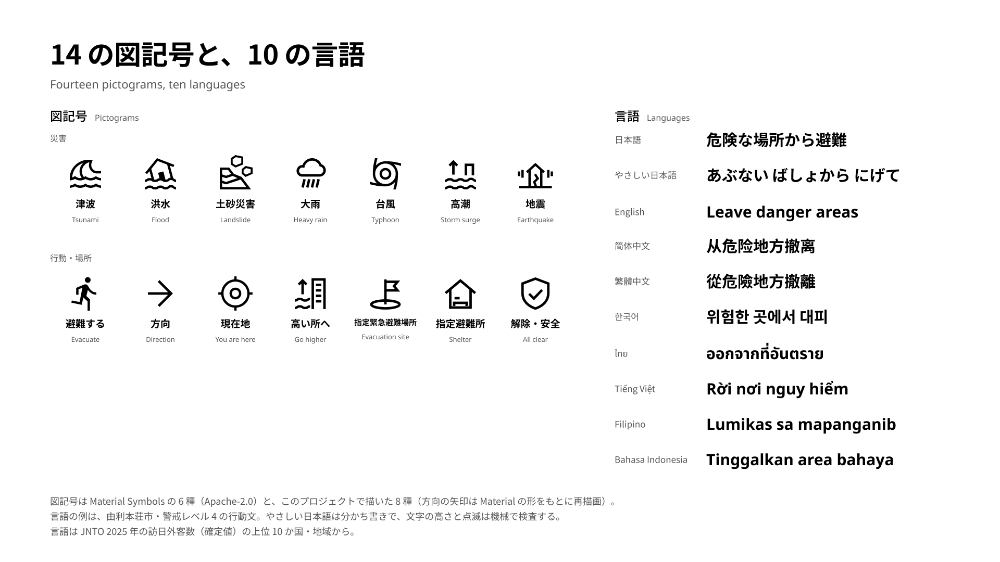
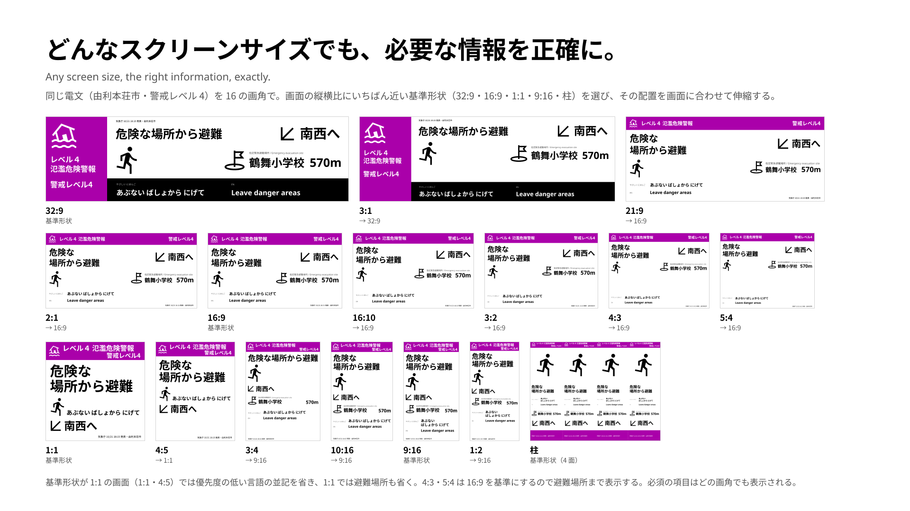
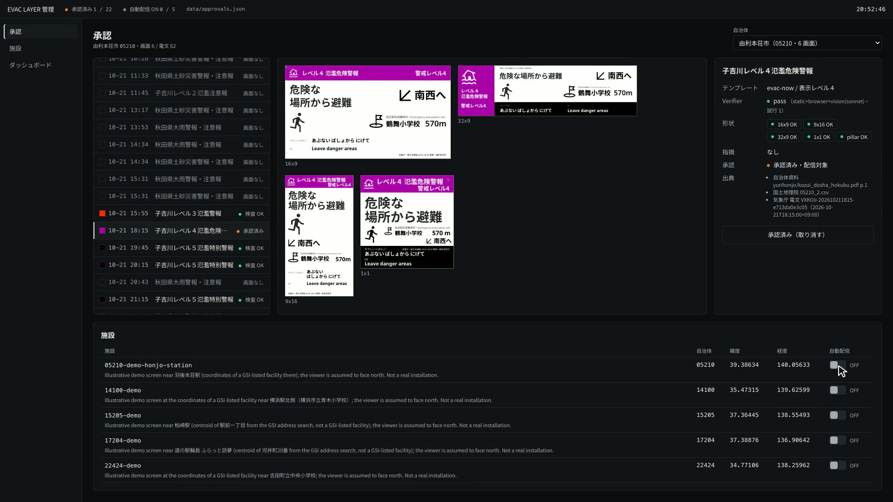
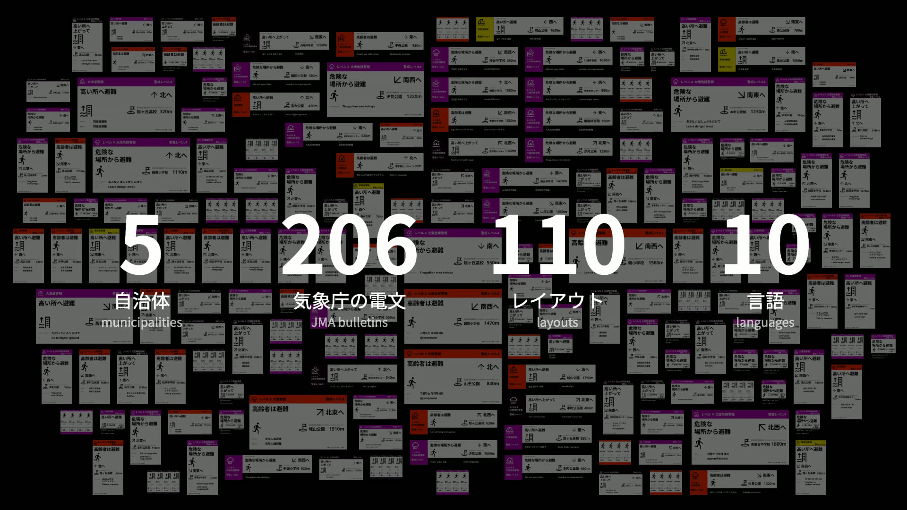
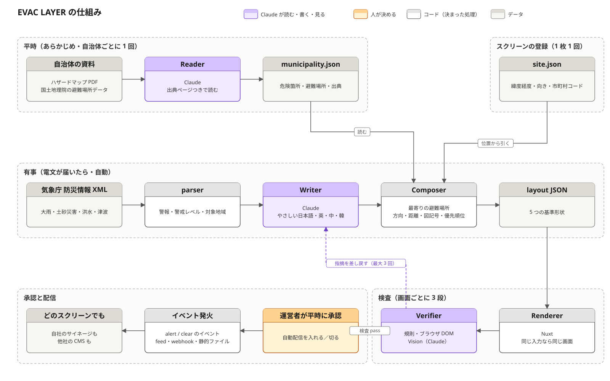

https://github.com/user-attachments/assets/36f29444-921e-4abf-bd5f-bd79b15147da

# EVAC LAYER

**EVAC LAYER は、いまある既存のサイネージに、災害時の緊急案内のレイヤーを自動で追加するシステムです。**
警報が届いた瞬間、街のスクリーンは、その場所に合った避難案内に変わります。

- **デモ動画（2 分 51 秒）**: [youtu.be/9XRmnF2DCsM](https://youtu.be/9XRmnF2DCsM)
- **触れるデモ**: [rettuce.github.io/evac-layer](https://rettuce.github.io/evac-layer/) — 駅のコンコースの 22 面を、平常時と警報時で切り替え、5 つのカメラで見られる 3D シミュレーター
- **English**: [summary ↓](#english-summary)

**何が新しいか**

- スクリーンが自分の場所を知り、その場所のための避難先・方向・距離を出す
- 承認済みの画面だけが、警報の瞬間に自動で出る（出す前に人が見る）
- 実際に発表された気象庁の電文 206 本で作り、規則・ブラウザ・Vision の 3 段で検査した
- 既存のどのサイネージにも、HTTP で 1 枚のレイヤーとして載る。特定の製品のために閉じていない

> **IDEA**
>
> 街中にあるスクリーン。
> それらが自分の位置を知り、災害時に適切な避難情報を出す。
> そんなハックができないか？

## できること

デモ動画とシミュレーターの切り替えは、記録した実際の電文を再生したものです。実際の運用では、`pnpm -F agents receive` が気象庁のフィードを読み、その施設に当たる新しい電文から画面を作って、承認済みなら表示を切り替えます。自前の受信系から `POST /api/admin/live` を呼ぶこともできます。

### 警報が届いた瞬間、すべてのスクリーンが切り替わる



2026 年 10 月 21 日に秋田県由利本荘市で実際に発表された警報で動かしたものです。平常時の環境映像（左上）から、子吉川の氾濫警報（警戒レベル 3）、氾濫危険警報（レベル 4）、氾濫特別警報（レベル 5）へ。柱・壁・天井の帯のスクリーンが、電文が届いた同じ瞬間に、それぞれの形に合った画面へ切り替わります。

### スクリーンが自分の場所を知っている



同じ警報でも、スクリーンの位置が違えば、避難先も方向も距離も変わります。上の 4 枚は、同じレベル 4 の警報を、市内の 4 か所に置いたスクリーンで描いたものです（南西へ 570 m・東へ 160 m・南東へ 210 m・北へ 80 m）。スクリーンの緯度経度と向きから、国土地理院の指定緊急避難場所のうち最寄りの場所を選び、見る人から見た方向と距離を出します。

### 災害の種類とレベル、10 の言語、どんな形のスクリーンにも



気象庁の 4 種類の電文（大雨・土砂災害・指定河川の洪水・津波）から、警戒レベル 3 以上と解除の画面を作ります。色は内閣府の警戒レベル 1〜5 の原典の値で、色の帯の上の文字はすべてコントラスト 4.5:1 以上です。



行動を表す図記号は 14 種類（Material Symbols 6・描き直し 1・自作 7）。行動の文は 10 の言語で書きます。日本語・やさしい日本語・英語・簡体字中国語・繁体字中国語・韓国語・タイ語・ベトナム語・フィリピン語・インドネシア語で、日本政府観光局（JNTO）の 2025 年の訪日客数の上位 10 か国・地域から選びました。



画面の形は 5 つに限りません。16:9・9:16・32:9・1:1・柱に巻く LED の 5 つを基準のグリッドとして持ち、`/screen?w=<px>&h=<px>` にどんな縦横比を渡しても、いちばん近いグリッドを選んで、余った広さを伸び縮みする行と列に配ります。それでも入りきらないときは優先度の低い項目から外し、避難の方向と必ず出す項目は残すので、レイアウトは崩れません。上の図は、同じレベル 4 の電文を 16 種類の縦横比で描いたもので、どの比率でも必ず出す項目が欠けていません。形状ごと・レベルごとの全画面は [`docs/screens.md`](docs/screens.md)。

### 何を出すかは、事前に人が決める



EVAC LAYER が作るのは下書きです。施設ごとに、災害 × 警戒レベル × 形状の画面を一式作り、各画面に出典（自治体の資料のページ・国土地理院のデータ・気象庁の電文 ID）と自動検査の結果を添えます。運営者は平常時にそれを確かめて承認し、施設ごとに自動配信を入れます。電文が届いたら、承認済みの画面だけが自動で表示されます。その時点で新しく生成したり、判断を挟んだりはしません。止めるのも運営者で、`/admin` で自動配信を切れば、次の電文からは表示されません。

### 実際の電文で作り、検査した



3 週間かけて記録した、5 つの自治体に関わる気象庁の電文 206 本（うち 6 本は気象庁の公式のサンプル電文で、訓練の電文）から、110 のレイアウト（画面を出す 22 本 × 5 形状）を作りました。背景のタイルは、画面の並びを見せるための架空の例です。実際の電文から作った画面は [`docs/screens.md`](docs/screens.md) にあります。すべての画面を、規則の検査・ブラウザでの描画の検査・Claude の画像認識（Vision）による検査の 3 段で確かめています。実データで見つかった問題は[下に](#実データで見つかったこと)まとめています。

## なぜ作るか

私はこれまで、駅や商業施設など街の公共空間のサイネージを、10 年以上作ってきました。同期した LED の壁、駅のホームのサイネージ、ロビーのスクリーン。しかし、それらは災害のとき、自分から情報を出すことができません。広告を流し続けるか、黒く消えるかのどちらかです。既存の仕組み（CAP 連携のサイネージや公的な配信基盤）が決めているのは「画面を切り替える」ところまでで、切り替えたあとに、**この**場所で、目の前の人に何を出すかは決まっていません。

2024 年 1 月 1 日の能登半島地震の津波のあと、新潟県上越市は検証で「防災行政無線による避難の呼びかけを受けた外国人や市外からの来訪者が、自身の避難の必要性や、どこに避難すればよいかを判断することが難しかった。」と書いています。呼びかけは届いた。けれど、その次の一言、たとえば**「南西へ、570 m」**は届いていませんでした。

スクリーンはもう街にあり、自分がどこにあるかも分かります。足りないのは、その場所のための避難案内です。EVAC LAYER はそれを Claude で作り、既存のサイネージに 1 枚のレイヤーとして重ねます。

## 仕組み

平常時に先に走る部分と、電文が届いたときに走る部分の 2 層です。



1. **読む**（Reader・Claude） — 自治体のハザードマップ PDF と国土地理院の指定緊急避難場所のデータを読み、すべての記述に出典のページを残す。
2. **聞く**（parser） — 気象庁の防災情報 XML から、警報の種類・警戒レベル・対象の地域を判定する。
3. **書く**（Writer・Claude） — その施設とその電文のための案内を、10 の言語と図記号で書く。市町村だけが出せる避難情報の名称（「高齢者等避難」など）は使わない。
4. **組む・描く**（Composer・Renderer） — 同じ案内を 5 つの基準の形に組み、どんな縦横比にも収めて描く。文字の大きさは見る距離から決め、点滅はしない。
5. **検査する**（Verifier・Claude） — 規則・ブラウザ・Vision の 3 段で検査する。指摘は Writer に戻して書き直させ、直らなければパイプラインを止める。
6. **知らせる** — その場所の `alert` / `clear` のイベントを、全形状の承認済みの画面を添えて出す。

同じ入力からは、ピクセル単位で同じ画面が出ます。Renderer は仮想の時計で描くので、検査・書き出し・デモの録画がすべて一致します。

| ディレクトリ | 中身 |
|---|---|
| `agents/` | Reader・気象庁 XML の parser・Writer・Composer・Verifier・書き直しのループ・一括処理・書き出し（[`agents/README.md`](agents/README.md)） |
| `app/` | Renderer（`/screen`）・運営者の画面（`/admin`・`/dashboard`）・承認・フィードと Webhook の配信（[`app/README.md`](app/README.md)） |
| `schema/` | agents と app の間の取り決め（layout・alert・site・municipality・feed・書き出し） |
| `data/` | デモの 5 自治体の知識ファイル・施設・レイアウト・検査レポート |
| `sim/` | ブラウザで動くコンコースの 3D シミュレーター（[`sim/README.md`](sim/README.md)） |
| `demo/` | Blender のコンコース・録画・動画の合成 |
| `examples/minimal-cms/` | フィードだけで動く 40 行のサイネージ |

## あなたのサイネージに導入する

EVAC LAYER は、画面を再生する機能を持たず、サイネージのシステムを置き換えません。サイネージに「この場所で、いま、これを出す」と伝えるだけです。やり取りはふつうの HTTP で、運ぶのは承認済みの画面だけです。作者が IE3 で運用しているサイネージも、ハッカソンの後に同じ口で受ける形で組み込みます（いまは設計まで）。

1. **施設を登録する** — `data/sites/<id>.json` に、緯度経度・画面の向き・市町村コードを書きます（[`schema/site.schema.json`](schema/site.schema.json)）。1 つのファイルが 1 つの施設で、その施設のスクリーンは同じ緯度経度を使います。同じ自治体に施設をいくつ置いてもかまいません。
2. **画面を作って承認する** — `pnpm -F agents fanout --sites <id>` でその施設の画面を一式作り、`/admin` で確かめて承認し、自動配信を入れます。
3. **受け取る** — 3 つの方法のどれかで受け取ります。
   - **Pull**: `GET /api/feed/<site>` を定期的に読む。その施設がいま出すべきものが、5 形状のレイアウトと PNG / HTML つきで返ります。`ETag` に対応しているので、こまめに読んでも軽い。
   - **Push**: 施設ごとの Webhook。HMAC-SHA256 の署名と時刻・配信 ID つきで、なりすましと再送を防げます。
   - **Files**: `pnpm -F agents export --site <id>` で、形状ごとの PNG と、単体で開ける HTML を書き出します。画像しか受け取れない CMS 向けです。

表示を切り替えるのは `pnpm -F agents receive --sites <id>` です。気象庁の長期フィードを読み、その施設に当たる新しい電文から画面を作り、承認済みなら表示を切り替えます。自前の受信系があるなら、電文の ID を `POST /api/admin/live`（または `pnpm -F agents live`）に渡しても同じで、`null` を渡すと平常時に戻ります。手順と環境変数の全体は [`docs/integration.md`](docs/integration.md)。

回線が切れても、画面は直前の状態を保ち、60 秒を過ぎると「同期が途絶えている」印を出します。書き出したファイルを端末に置いておけば、配信元に届かなくても承認済みの画面を出せます。

## 既存の災害対応サイネージとの違い

公開資料で確認できた範囲では、国内の災害対応サイネージ（2012〜2019 年の大手メーカーの製品・実証）の災害時の動きは「公的な配信を受けて割り込み表示し、元に戻る」までです。EVAC LAYER はそこに次の点を足します。

- **スクリーンが自分の場所を知っている。** スクリーンごとの緯度経度から、最寄りの指定緊急避難場所を「どちらへ・何 m」で出します。資料にあったのは「どこに配信するか」の選び分けまででした。
- **全国の場所ごとの画面を、生成で作る。** 総務省のデジタルサイネージの相互運用のガイドライン（2016）は、「共通の形式が無く、システムごとに制作・個別開発・調整が要る」ことを課題に挙げています。自治体ごとの資料を読み、場所ごとの案内を組み、検査するところまでを Claude で回すのが、EVAC LAYER の答えです。
- **文言の品質を機械で確かめる。** やさしい日本語の規則、文字の高さ、点滅しないこと、距離の書き方、英語欄の文字の種類を、検査規則と Verifier で確かめます。
- **平常時も使うレイヤーである。** 災害のときだけ動く専用の機械ではなく、平常時は環境映像を流すサイネージに重ねる 1 枚のレイヤーです。
- **承認と自動配信を、施設ごとに持つ。** 施設ごとの承認と自動配信の設定は、確認できた資料にはありませんでした。
- **自治体は無償で使え、他社のサイネージにも載せられる。**

ここで「資料に無い」は資料に書かれていないという意味で、その機能が無いと確かめたわけではありません。

## 実データで見つかったこと

以下はすべて、気象庁の公式サンプルだけでは出てこなかった問題です。記録した気象庁の電文（4 種類・全国 703 本）と 5 自治体のハザードマップ PDF でパイプラインを回して見つけました。コミットつきの全件は [`agents/FINDINGS.md`](agents/FINDINGS.md)。

- **PDF のテキストから文字が消えていた**（「最大津波 16.6m」が「最 津波 16.6m」に）。文字の対応表を持たないフォントのためで、長さや文字の種類の検査では気づけません。Reader はそのテキストに疑わしいと印をつけ、`--allow-vision` でページを画像として読み直し、出典に `method: vision` と書きます。
- **レベル 5 の洪水の電文で、レベルが空になった。** 浸水が想定される区域が、水位の観測所ではなく堤防が切れる地点ごとに書かれていたためです。区域は予報区のレベルを引き継ぎ、判定できないレベルは「基準未満」とみなさず、理由を添えて止めます。
- **最初の一括処理では、22 枚のうち 9 枚が、出していない警報の「解除」の画面だった。** 再生の側で、災害の種類ごとに表示中の警報を覚え、出したものだけを解除するようにしました。
- **県の大雨注意報が、レベル 5 の画面を平常時に戻してしまった。** 表示の状態を、電文の系統ごとに持つようにしました。
- **長い施設名が、距離を画面の外へ押し出した。** 規則の検査では見えず、描いた PNG を見て分かりました。避難場所の欄は名前だけを持ち、種類の見出しは Renderer が固定で描きます。
- **Vision の検査は、最初に図記号の矛盾を 25 件見つけた**（解除の画面に「避難する」人の図記号など）。5 回の実行で 25 → 8 → 4 → 4 → 0。図記号は行動だけを表すことにし、Writer は書く前に図記号の意味を受け取ります。
- **Writer が、市町村の避難情報の名称を使った**（「高齢者等避難」）。気象庁の警報から作った画面にこう書くと、市が発令したように読めてしまうので、検査規則で禁じました。
- **英語の欄に漢字が入った**（「子吉川 Lv3 Flood Warning」）。英語の欄にラテン文字以外を禁じる検査規則を足しました。

API の費用（11 月 5 日までのデータ処理）は、Reader $2.88（5 自治体）、Writer 約 $7.08、Vision の検査 $11.34（19 回）で、合計約 $21.30 です。運用時は画面 1 枚あたり $0.245、1 自治体あたり年に約 $13 の見込みです。評価の数字と、全国に広げたときの粗い試算は [`docs/evaluation.md`](docs/evaluation.md)。

## Claude とどう作ったか

アプリのコアで Claude が担うのは 3 役です。承認・スキーマ・検査規則はモデルの外に固定してあり、モデルを入れ替えても「人が承認した画面しか出ない」は変わりません。

| 役 | モデル | すること | 実測 |
|---|---|---|---|
| Reader | Sonnet 5.5 | 自治体のハザードマップ PDF と国土地理院のデータを、出典のページつきの知識ファイルにする。文字が欠けた PDF はページを画像として読み直す | 5 自治体で $2.88。同じ輪島市の資料で Haiku は $0.009 で施設 19 件・津波の高さは取れず、Sonnet は $0.257 で施設 113 件（[`docs/how-we-built.md`](docs/how-we-built.md)） |
| Writer | Opus 5.5 | その施設とその電文のための行動の文を、形状ごとの字数の上限の中で 10 の言語で書く。検査の指摘を受けて書き直す | 約 $7.08。同じ警報から同じ画面が出るよう出力を記録 |
| Verifier（Vision） | Sonnet 5.5 | 描いた画面を形状ごとに電文と照らし、図記号の矛盾・欠落・はみ出しを指摘する | $11.34（19 回）。最初に 25 件を指摘し、5 回の実行で 25 → 8 → 4 → 4 → 0 |

作者は、ほぼ一人で物を作っています。防災の案内には、一人では到底できない物量があります。自治体ごとのハザードマップや気象庁の電文といった膨大な資料、都道府県をまたぐ情報の食い違い（市町村や場所ごとに、避難先も方向も言葉も違う）、千差万別のスクリーンのレイアウト。人がやれば時間も労力もコストも膨大にかかるこの作業を、システムとアルゴリズムの力と、AI を使った並列処理で一気に解こうと考えました。

11 月 2 日より前にあったのは、調査・コンセプト・データの利用条件の確認・元の PDF のダウンロード・気象庁のフィードの記録だけで、コードはありません。このリポジトリは、すべて 11 月 2 日 12:00 から書きました。

作者は 1 人です。11 月 7 日の時点で、commit は 728（うち統合が 239）、コードは約 2.1 万行、テストは 182 件になりました。作業の記録 571 項目のうち 181 項目は、作者が決めたことです。手を動かす量は Claude が担い、何を作るか・どう見せるかは作者が決めました。

Claude Code のセッションの 1 つが全体のまとめ役になり、8 つの実装のセッション（`agents`・`render`・`demo`・`layout`・`sim`、Figma の `brand`、文章の `copy`、音の `bgm`）が、それぞれの git worktree で並行して作業しました。まとめ役は仕様とセッションの間の取り決め（layout の JSON・Verifier が読む DOM の属性・承認の仕組み）を書き、各セッションの成果を `main` に取り込み、確かめて、足りなければ直し方を添えて戻します。作者はすべてのセッションを見ていて、必要なときは直接指示します。

- **3 段の検査と書き直しのループ。** 規則・ブラウザ・Vision の検査が先にあり、指摘は書いた本人に戻ります。Writer の文は書き直させ、コードが書く部分（気象庁の見出し・避難先・出典）の問題は理由を添えてループを止めます。
- **返却の最後に「確かめられなかったこと」と「未解決の点」。** 各セッションは、まとめ役から見えない前提や走らせられなかった検査を自分で書き、まとめ役は次に進む前にそれを 1 つずつ決めます。
- **承認はモデルの外に置いた。** スキーマ、Verifier が読む DOM の属性、承認の仕組みは固定してあり、モデルを入れ替えても、人が承認した画面しか出ないという決まりは変わりません。

コードを書く前の調べものと準備、モデルの選び方、提出前のレビューは、[`docs/how-we-built.md`](docs/how-we-built.md) の「Before the code / コードを書く前」にあります。

詳しくは [`docs/how-we-built.md`](docs/how-we-built.md)。

## 動かす

```sh
pnpm install
pnpm -F app dev                     # Renderer と運営者の画面 http://127.0.0.1:3150（/ は /admin へ）
pnpm -F app demo:approve            # デモの 6 電文を承認し、施設の自動配信を ON（初回だけ。data/approvals.json）
open "http://127.0.0.1:3150/screen?site=05210-demo-honjo-station&mode=live&reset"   # 約 15 秒でレベル 3、約 21 秒でレベル 4
pnpm -F agents test
pnpm -F app test
```

承認していない画面は出ない作りなので、デモでは `demo:approve` で 6 件を承認します（`/admin` で 1 件ずつ承認しても同じです。API で承認する手順は [`docs/integration.md`](docs/integration.md) の §2）。`&reset` を付けないと再生の途中から始まり、1 分を過ぎると解除の画面のままになります。

デモの 5 自治体の知識ファイル・レイアウト・検査レポートを同梱しているので、運営者の画面は API キーなしで動きます。設定は環境変数か、リポジトリ直下の `.env` で渡します（項目は `.env.example`）。Reader・Writer・Vision の検査を自分で回すには `ANTHROPIC_API_KEY` が要ります。コマンドと費用は [`agents/README.md`](agents/README.md)。

再配布していない元データ（自治体の PDF・国土地理院の CSV・記録した気象庁の電文）は `EVAC_RAW_DIR`（既定は `data/raw`）に置きます。`pnpm -F agents test` は 104 件で、元データが無いと電文を読む 39 件を飛ばし、置き場所と入手先を表示します。`pnpm -F app test` は 78 件です。

ポート 3150 が使用中なら、`pnpm -F app exec nuxt dev --port <n>` で別のポートに立て、agents と `demo:approve` からは `EVAC_URL=http://127.0.0.1:<n>` で同じポートを指します。

公開しているのは、ブラウザで動く静的なシミュレーター（GitHub Pages）だけで、そこから Claude の API を呼ぶ経路はありません。Reader・Writer と運営者の画面は、手元で自分の API キーを使って動かします。

## データと権利

- **気象庁 防災情報 XML** — 気象警報・注意報などは、気象庁防災情報 XML（出典: 気象庁ホームページ https://xml.kishou.go.jp/ ）を利用しています。EVAC LAYER はこれを独自に編集し、やさしい日本語と多言語に言い換えて表示しており、編集の責任は EVAC LAYER にあります。警報の名称・警戒レベル・対象の地域は気象庁の発表のまま表示し、独自の予報はしません。使ったのは公式のサンプル電文と、2026 年 10 月から記録した長期フィードの電文です。記録したフィードは再配布せず、デモの自治体の再生に使う電文だけを含みます。
- **国土地理院 指定緊急避難場所・指定避難所データ** — 指定緊急避難場所は「指定緊急避難場所・指定避難所データ」（国土地理院）https://www.gsi.go.jp/bousaichiri/hinanbasho.html をもとに、EVAC LAYER が加工して作成しました（公共データ利用規約 第 1.0 版）。データは市町村が登録したもので、最新でない場合や載っていない場合があります。施設の最新の情報は、各市町村に確認してください。出典は各画面の配信データ（`sources`）と単体の HTML にも入れています。
- **自治体のハザードマップ PDF** — 各自治体のサイトから読み、`data/municipalities/*.json` にファイル名とページで引用しています。PDF は再配布しません。
- **警戒レベルの色** — 内閣府の 5 段階の原典の値。
- **図記号** — Material Symbols（Apache-2.0）6 種、Material の形をもとに描き直した 1 種、このプロジェクトで描いた 7 種（[`app/ASSETS.md`](app/ASSETS.md)）。JIS Z 8210 / Z 9098 の図記号ではありません。
- **フォント** — Noto Sans JP / SC / TC / KR / Thai と Noto Sans（SIL OFL 1.1）。オフラインでも描けるよう同梱しています。
- **3D のデモ** — Poly Haven の HDRI とテクスチャ（CC0）。地図は OpenStreetMap（© OpenStreetMap contributors）（[`demo/ASSETS.md`](demo/ASSETS.md)）。
- **動画の音と README の画像** — BGM は Suno で作成（作成者所有）、効果音は Adobe Audition SFX。README の画像はこのリポジトリで描いたもので、出所は [`demo/ASSETS.md`](demo/ASSETS.md)。

## EVAC LAYER がしないこと

- **警報を出しません。** 公式の警報の経路を置き換えず、気象庁の電文を受けて画面を描くだけです。
- **避難情報を発令しません。** 発令は市町村の役割です。Writer がその名称を使えないよう、検査規則で禁じています。
- **停電には対応しません。** 建物が停電すれば、画面は消えます。
- **サイネージの CMS ではありません。** 作るのは緊急時の画面と、それを出すかどうかの承認までです。画面を流すのは、いま使っている CMS です。
- **実際の運用と、自治体による検証はまだしていません。** 画面はすべて、記録した電文と公式のサンプル電文で作って確かめたものです。
- **避難先は Claude が選びません。** 国土地理院のデータから規則で選びます。Claude が担うのは、文章を書くことと検査です。
- **距離と方向は、直線の距離と方角です。** 道のりや、浸水が想定される区域は考えていません。

## この先

- **どのサイネージにも組み込める。** EVAC LAYER は特定のサイネージ専用に閉じていません。承認済みの画面を HTTP（Pull・署名付きの Webhook・ファイル）で渡すだけなので、サイネージのソフトウェアを作る人なら誰でも、自分のシステムに同じように組み込めます（40 行の例: [`examples/minimal-cms/`](examples/minimal-cms/)）。
- **自分たちのサイネージで動かす。** その最初の 1 件として、作者が IE3 で開発している環境演出のシステムに、オプションの 1 枚のレイヤーとして組み込みます。いまは設計まで済んでいて、ハッカソンの後に同じ口で受ける開発を進めます。平常時の演出はそのシステムが、災害のときだけ EVAC LAYER が画面を受け持ちます。
- **実証の相手を探しています。** 記録した 5 自治体（由利本荘市・横浜市・柏崎市・輪島市・吉田町）の資料と電文で画面は作ってあります。サイネージを持つ施設、自治体、組み込みたい事業者の方は [ie3.jp/contact](https://ie3.jp/contact/) へ。
- **公開のまま続けます。** 審査の期間は main を止め、その後も AGPL-3.0 のまま開発を続けます。

## 今後

- **全国の自治体への展開。** API の費用を、いまの数字から粗く見積もると、全 1,740 自治体の資料を読むのに初回だけ $500〜2,000、各自治体に 1 施設ずつ置いて年に約 $22,000、全国 1 万施設で年に約 $47,000 です。前提と内訳は [`docs/evaluation.md`](docs/evaluation.md#what-a-nationwide-roll-out-would-cost-in-api-calls)。
- **言語の選択と、母語話者による確認。** いまは 10 言語すべてが必須で、導入先ごとに言語を絞ったり入れ替えたりできません。やさしい日本語以外の訳は、母語話者の確認をまだしていません。
- **津波予報区の全国対応。** 気象庁の津波予報区と市町村の対応表は、いまはデモの 5 自治体の分だけです。気象庁のコード表から全国分を作ります。
- **緯度経度からの自治体の判定。** いまは市町村コードを手で書きます。

## ライセンスと連絡先

AGPL-3.0（[`LICENSE`](LICENSE)）。Copyright (C) 2026 You Tanaka。
AGPL-3.0 の条件で、誰でも使えます。AGPL の条件で公開できない製品への組み込みには、別のライセンスも用意します。

このハッカソンは、公開リポジトリで提出することが条件でした。作者の普段の仕事のコードは非公開ばかりです。どうせ公開するなら、オープンソースにして、誰もが使える未来として提案するほうが健全だと考えました。普段の創作活動に社会的な意義を付けられれば、その活動も続けていきやすくなります。EVAC LAYER は、作者たちの環境演出のシステムにも、ハッカソンの後に 1 枚のレイヤーとして組み込みます（いまは設計まで）。そのレイヤーは、誰でも使えるオープンソースです。

導入や連携の相談: [ie3.jp/contact](https://ie3.jp/contact/)（IE3）。ハッカソンの期間中（11 月 2〜8 日）は、外部からのコントリビューションを受け付けていません（[`CONTRIBUTING.md`](CONTRIBUTING.md)）。

**Built with Claude: Japan 2026**（2026 年 11 月 2〜8 日）の期間中に、ゼロから作りました。

## English summary

**EVAC LAYER adds an emergency-guidance layer to the signage a city already has, automatically, when disaster strikes.** The moment a warning arrives, every screen turns into evacuation guidance for the spot where it stands. Demo video (2:51): https://youtu.be/9XRmnF2DCsM

> **IDEA** — Screens are everywhere in the city. What if each one knew where it stands, and showed the right evacuation guidance when disaster strikes?

Give EVAC LAYER the latitude, longitude and facing of a site (one venue; its screens share them) and its municipality code, written by hand, and it works out the rest for that spot: the nearest designated evacuation site from GSI data, and the direction and distance from where the viewer stands. The same warning gives each site its own shelter, direction and distance, and a municipality can hold any number of sites. It reads the municipality's hazard-map PDFs with citations (Reader, Claude), parses JMA disaster-prevention XML, writes the guidance in ten languages (Japanese, *yasashii nihongo*, English, Simplified and Traditional Chinese, Korean, Thai, Vietnamese, Filipino and Indonesian) with action pictograms (Writer, Claude), composes it for five base shapes that fit any aspect ratio, and inspects every screen by rules, in a browser and by Vision (Claude). Operators approve the screens in calm times; when a bulletin arrives, only approved screens go out, as `alert` / `clear` events by feed, signed webhook or static files. From 206 JMA bulletins for five municipalities (200 recorded from the live feed, 6 official sample bulletins from a drill) it made 110 layouts.

To add your own screens: register a site file, generate and approve its screens once, then take the feed, the webhook or the files. `pnpm -F agents receive --sites <id>` reads the JMA long feeds, composes the screens of each new bulletin that concerns the site and switches the site once they are approved; a receiver of your own can switch a site by posting a bulletin id (or `null`) to `POST /api/admin/live`. The switches in the demo video and the simulator are replays of recorded bulletins. The steps are in [`docs/integration.md`](docs/integration.md). In steady state a screen costs about $0.245 in API calls, roughly $13 per municipality per year.

EVAC LAYER does not issue warnings or evacuation orders and has not yet been run in operation or checked by a municipality; evacuation sites are chosen from GSI data by rule (Claude writes and checks the text), and direction and distance are straight-line. JMA data is edited and translated under EVAC LAYER's responsibility with no forecast of its own, and the GSI data should be confirmed with each municipality. The only thing deployed publicly is the static simulator on GitHub Pages, and nothing there calls the Claude API. Built from scratch during Built with Claude: Japan 2026 (Nov 2–8) by one lead Claude Code session and eight implementation sessions on their own git worktrees. The author works almost alone, and the volume here (hazard maps and bulletins, guidance that differs for every place, layouts for every kind of screen) is more than one person could do, so it is solved with systems, algorithms and Claude working in parallel. The hackathon required a public repository; the author's everyday work is almost all private, so it seemed healthier to make this open source and offer it as a future anyone can use, and giving everyday creative work a social purpose makes that work easier to keep going. After the hackathon EVAC LAYER will be built into the author's team's own ambient-signage system as one layer (the design is done; the integration is not), and that layer is open for anyone. What happened before the code (research, the recorded feed, the model choice and the review before submission) is in "Before the code" in [`docs/how-we-built.md`](docs/how-we-built.md). Licensed AGPL-3.0 for anyone; a separate license is available for products that cannot be published under the AGPL: [ie3.jp/contact](https://ie3.jp/contact/).
