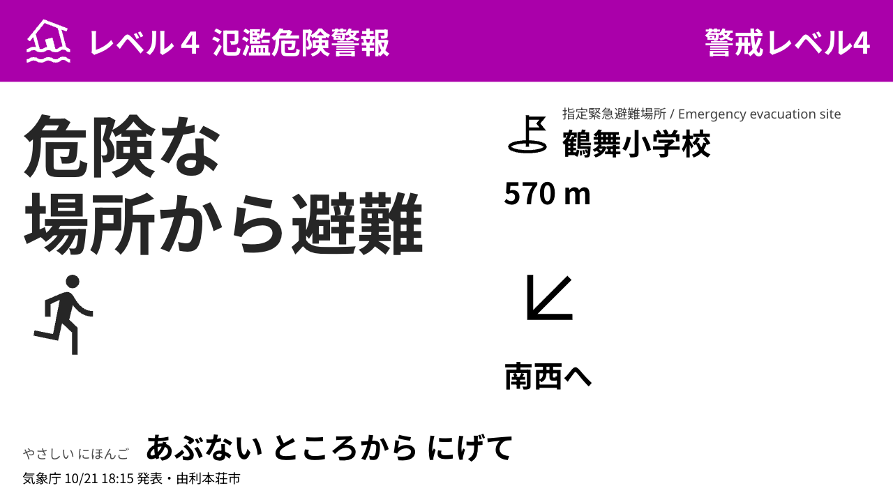
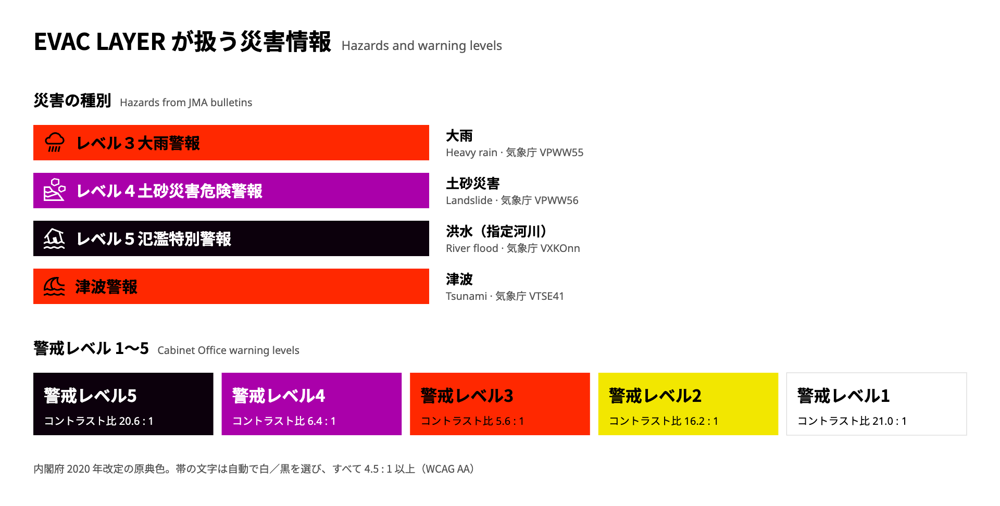
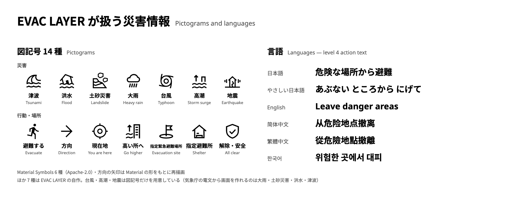
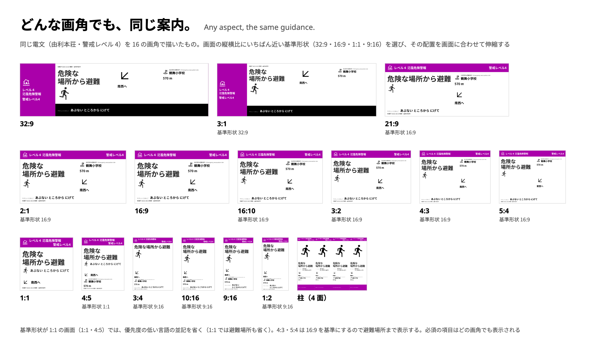

<picture>
  <source media="(prefers-color-scheme: dark)" srcset="docs/brand/evac-layer-logo-1line-black.svg">
  
</picture>

# EVAC LAYER

**スクリーンはもうある。**
街にすでにあるスクリーンを、いちばん伝えなければならない瞬間に、誰にでも読める避難案内へ変える。

*The screens are already there.* Turn the screens a city already has into evacuation guidance anyone can read. [English summary ↓](#english-summary)



[全画面（形状ごと・レベルごと・柱・平時レイヤー・切替）→](docs/screens.md)

**Built with Claude: Japan 2026**（2026-11-02〜08）の期間中にゼロから作っています。状態: Day 3。パイプラインは実データで端から端まで動き、デモ動画と仕上げが進行中。

[デモ動画 — 11/8 公開]

## 何ができるか（3 枚で）



気象庁の 4 種別の電文（大雨・土砂災害・指定河川の洪水・津波）と、内閣府の警戒レベル 1〜5（原典色・帯の文字はすべてコントラスト 4.5:1 以上）。



行動の図記号 14 種（Material Symbols 6・描き直し 1・自作 7）と、日本語・やさしい日本語・英語・中国語（簡体・繁体）・韓国語の行動文。



画面の形は 5 つに限りません。`/screen?w=<px>&h=<px>` にどんな画角を渡しても、比率にいちばん近い基準形状（横長・超横長・縦長・正方形）を選び、その基準のキャンバスを画面に収めて描くので、レイアウトは崩れません。上の図は同じ Lv4 電文を 16 の画角で実際に描いたもので、必ず出す項目が欠けた画角はありません。再生成は `pnpm -F app coverage`。

## なぜ作るか

**乗っ取ったあと、何を描くか。**

私は駅や商業施設で「情報を伝える光」を作ってきました。同期した LED 壁、ホームのサイネージ、ロビーのスクリーン。災害のとき、それらの画面は 2 つのうちどちらかになります。広告を流し続けるか、黒く落ちるか。既存の仕組み（CAP 連携のサイネージや公的な配信基盤）は「画面を乗っ取る」ことまでを決めて、そこで止まります。その先に、**この**画面で、**この**建物で、目の前の人に何を描くかは、誰も決めていません。

目の前の人は抽象的な存在ではありません。2024 年 1 月 1 日の能登半島地震の津波のあと、新潟県上越市は検証で「外国人や市外からの来訪者が、どこに避難すればよいかを判断することが難しかった」と書いています。警報は届いた。その次の一文、**「そこへ、あちらへ、570 m」**が届いていない。

スクリーンはもうあり、自分の場所を知っている。足りないのは、乗っ取ったあとにその場所のために何を描くかです。EVAC LAYER はそれを、全国のどの画面にも、Claude で作ります。国内のサイネージに 1 枚のレイヤーを足すことで、すでにある全国のスクリーンを防災情報に対応したものにする。それがこのプロジェクトの考えです。

## 何をするか

EVAC LAYER に画面の座標を渡します。コンコースの柱、商業施設の壁、ロビーのディスプレイ。あとはその場所のために自分で引きます。どの市町村の電文が当たるか、国土地理院のデータで最寄りの指定緊急避難場所はどこか、見る人の立ち位置からの方向と距離はいくらか。同じパイプラインがどの座標でも走るので、1 施設でも全国 1 万枚でも同じ仕事です。自治体ごとに 1 回読み、画面ごとに 1 回組む。画面ごとに、次を行います。

1. **読む** — その自治体のハザードマップ PDF と国土地理院の指定緊急避難場所データを読み、すべての記述に出典ページを残す。
2. **聞く** — 気象庁の防災情報 XML（2026 年 10 月から記録している実フィード）を受け、警報・内閣府の警戒レベル（1〜5）・対象地域を判定する。
3. **書く** — その施設・その電文のための案内を書く。行動を日本語・やさしい日本語・英語・中国語・韓国語で、行動の図記号つきで。市町村だけが出せる避難情報の名称は使わない。
4. **組んで描く** — 同じ案内を 5 つの基準形状（16:9・9:16・32:9・1:1・柱に巻く LED）に組み、Renderer はどんな画角にもいちばん近い基準形状を収めて描く。視距離から導いた文字サイズ、内閣府原典の警戒レベル色、点滅なし。
5. **検査する** — すべての画面を 3 段で。スキーマと規則、描画した DOM のブラウザ検査（溢れ・欠け・距離の重複）、PNG を電文と照らす Vision 検査。指摘は Writer に戻し、書き直しで直らないものはパイプラインを止める。
6. **イベントを発火する** — 電文が届いたら、その場所の `alert` / `clear` イベントを、全形状の承認済み画面を添えて出す。フィード、署名つき Webhook、静的ファイル。どのサイネージシステムでも受けられる。

1 施設分の出力は一式です。災害種別 × レベル × 形状。各画面には気象庁の発表時刻と自治体名が小さく入り、出典の詳細（自治体 PDF のページ、国土地理院のデータ、気象庁の電文 ID）と検査レポートは画面に付いて配信されます。

## 仕組み

2 層です。遅い層はあらかじめ走り、速い層は電文が届いたときに走ります。


- `agents/` — Reader・気象庁 XML の parser・Writer・Composer・Verifier・差し戻しループ・記録した電文の一括処理・エクスポート。コマンドは `agents/README.md`。
- `app/` — Renderer と運営者の画面（`/screen`・`/admin`・`/dashboard`）、承認ゲート、フィードと Webhook の配信。`app/README.md`。
- `schema/` — 両者の契約: layout・alert・municipality・feed・export manifest。
- `data/` — デモ自治体の知識ファイル・レイアウト・検査レポート。元の PDF と記録した気象庁フィードは再配布しません。
- `demo/` — Blender のコンコース、同じ入力で同じ画面になる録画、動画の合成。

同じ入力から同じ画面が出ることが要です。Renderer は仮想時計を持ち、同じレイアウトの同じ `t` は同じピクセルになります。だから Verifier・エクスポート・デモの録画が一致します。

## 人が決める

**平時に決めて、有事は自動。**

EVAC LAYER は下書きを作ります。決めるのは人で、あらかじめ決めます。施設ごとに案内画面の一式（災害 × レベル × 言語 × 形状）を生成し、各画面には出典（自治体 PDF のページと気象庁電文の ID）と自動検査のレポートが付く。運営者は平時に一式を確認して承認し、その施設の自動配信を入れるか切るかを決めます。電文が届いたら、承認済みの画面だけが自動で上がります。そこに生成や判断は挟まりません。止めるのも運営者で、`/admin` から自動配信を切れば次の電文から出ません。

## どの画面にも

EVAC LAYER はイベントの発信元であって、画面を再生する装置ではありません。サイネージシステムを置き換えず、サイネージに「この場所に、いま、これを出す」と伝えます。私が運用しているサイネージにも、あなたのサイネージにも。配信はふつうの HTTP で、承認済みの画面だけを運びます。

- **Pull** — `GET /api/feed/<site>`: その施設がいま出すべきもの。5 形状のレイアウトと PNG/HTML の資産つき。`ETag` でポーリングは軽い。
- **Push** — 施設ごとの Webhook。timestamp・delivery id・event・body に対する HMAC-SHA256 の署名つき。再送攻撃に耐える。
- **Files** — `pnpm -F agents export --site <id>`: 形状ごとの PNG と、単体で開ける HTML。画像しか受けられない CMS 向け。

画面の登録は、座標・向き・市町村コードを持つ JSON ファイル 1 つ（`data/sites/<id>.json`）。以後その画面は自分の場所のための案内を受け取り、`POST /api/admin/site` で自動配信を入れます。手順は `docs/integration.md`。`examples/minimal-cms/` はフィードだけで動く 30 行のサイネージクライアントで、デモ動画の最後のカットがそれです。

停電・回線断について。静的ファイルの経路を使えば、承認済みの一式を端末側に置いておけます。画面は配信元に届かなくなっても直前の状態を保ち、60 秒を超えると「更新が止まっている」印を出します。建物が停電すれば画面は消えます。EVAC LAYER は電源の約束をしません。

## 既存の災害対応サイネージとの違い

公開資料で確認できた範囲では、国内の災害対応サイネージ（2012〜2019 年の大手メーカー・実証）の災害時モードは「公的な配信を受けて割り込み表示し、復帰する」ところまでです。EVAC LAYER が足すのは次の点です。

- **画面が自分の場所を知っている。** ディスプレイごとの緯度経度から、最寄りの指定緊急避難場所を「ここから何 m・どちらへ」で出す。資料にある粒度は「配信先の選別」まで。
- **全国のバリエーションを生成で作る。** 総務省の相互運用ガイドライン（2016）は「共通フォーマットが無く、システムごとに制作・個別開発・調整が要る」ことを課題として書いています。自治体ごとの資料を読み、画面ごとの案内を組み、検査する工程を Claude で回すことが、その課題への答えです。
- **文言の品質を機械で保証する。** やさしい日本語の規則、文字の高さ、点滅なし、距離の表記、英語欄の文字種を、検査規則と Verifier で確かめます。
- **平時の価値が設置費を払う。** 災害時だけ動く機械ではなく、環境演出の基盤の上に乗る 1 枚のレイヤーです。
- **割り込みと復帰、承認と自動配信を構造で持つ。** 施設ごとの承認フローと自動配信の設定は、確認できた資料にはありませんでした。
- **自治体は無償で、他社のサイネージにも乗せられる。**

「記載なし」は資料に記述が無いことで、機能が無いことではありません。

## 実データが見つけたこと

以下はすべて、公式サンプルではなく実データ（記録した気象庁電文 703 本と 5 自治体のハザードマップ PDF）でパイプラインを回して見つけたものです。コミットつきの全表は `agents/FINDINGS.md`。

- **PDF のテキスト層から文字が消える**（「最大津波 16.6m」→「最 津波 16.6m」）。ToUnicode の無い CID フォントで、長さや文字種の検査では見えない。Reader はその層を疑わしいと印し、`--allow-vision` でページ画像を読み直して `method: vision` と出典に書く。
- **レベル 5 の洪水電文がレベル null になった。** 浸水想定の区域は水位観測所でなく破堤点ごとに書かれている。区域は予報区のレベルを継承し、判定できないレベルは「閾値未満」でなく理由つきで停止する。
- **22 画面中 9 枚が、出していない警報の「解除」だった。** 再生側は災害種別ごとに表示中の警報を持ち、出したものだけ解除する。
- **県の大雨注意報がレベル 5 の画面を平時に戻した。** ライブの状態は電文の系列ごとに持つ。
- **長い施設名が距離を画面の外へ押し出した。** 静的検査では見えず、描画した PNG を見て分かった。避難場所セルは名称だけを持ち、Renderer が固定の種別ラベルを描く。
- **Vision 検査の初回は図記号の矛盾を 25 件見つけた**（解除画面に「避難」の人型）。5 回の実行で 25 → 8 → 4 → 4 → 0。行動の図記号は行動だけを表し、Writer は書く前に図記号の意味を受け取る。
- **Writer が市町村の避難情報の名称を使った**（「高齢者等避難」）。気象庁の警報から作った画面に書くと、市が発令したように読める。検査規則で禁止した。
- **英語欄に漢字が入った**（「子吉川 Lv3 Flood Warning」）。`en` に非ラテン文字を禁じる検査規則を足した。

API の費用（ここまでのデータ処理）: Reader $2.88（5 自治体）、Writer 約 $2.75、Vision 検査 $5.17（9 回）。評価の数字は `docs/evaluation.md`。

## データと権利

- **気象庁 防災情報 XML** — 公式サンプル電文を無加工で再生したものと、2026 年 10 月から公開の長期フィードを記録した電文。記録したフィードは再配布せず、デモ自治体の再生用の電文だけを含みます。
- **国土地理院 指定緊急避難場所・指定避難所データ** — Public Data License 1.0。出典は各画面の配信データ（`sources`）と自己完結 HTML に入り、施設の詳細は市町村で確認する旨の注記つき。
- **自治体のハザードマップ PDF** — 各自治体のサイトから読み、`data/municipalities/*.json` にファイルとページで引用。PDF は再配布しません。
- **警戒レベルの色** — 内閣府の 5 段階の原典値。
- **図記号** — Material Symbols（Apache-2.0）6 種、Material の形をもとに描き直した 1 種、このプロジェクトで描いた 7 種。`app/ASSETS.md`。
- **フォント** — Noto Sans JP / SC / TC / KR（SIL OFL 1.1）。画面がオフラインで描けるよう同梱。
- **3D デモ** — Poly Haven の HDRI とテクスチャ（CC0）。地図は OpenStreetMap（© OpenStreetMap contributors）。`demo/ASSETS.md`。

## これではないもの

- 公式の警報経路を置き換えるものではありません。EVAC LAYER は気象庁の電文の下流にあって画面を描くもので、警報を出しません。
- 避難情報を発令するものではありません。発令は市町村のもので、Writer はその名称を使えないよう検査規則で禁じています。
- 電源の約束ではありません。建物が停電すれば画面は消えます。
- 汎用のサイネージ CMS ではありません。緊急画面を作って承認で止めるものです。出すのはあなたの CMS です。

## ハッカソン期間中の作り方

11 月 2 日より前: 調査、コンセプト、データの利用条件、元 PDF のダウンロード、気象庁フィードの記録。コードはありません。このリポジトリのすべては 11 月 2 日 12:00 JST から書きました。

1 段落で言うと: Claude Code のセッション 1 つが司令官になり、実装の 3 席（`agents`・`render`・`demo`）がそれぞれの git worktree で tmux セッションとして走ります。司令官が仕様と席間の契約（layout JSON・Verifier が読む DOM 属性・承認ゲート）を書き、`work/*` を `main` に統合し、検収するか差し戻します。席は結果・確認できなかったこと・未解決点を返し、司令官が裁定して直し方を戻します。テスト・型検査・同じ入力で同じ画面になる録画は席が自分で回す検査、Vision 検査とブラウザ検査はパイプラインが自分の出力に回す検査です。席・契約・差し戻しループの詳細は `docs/how-we-built.md`。

## 動かす

```sh
pnpm install
pnpm -F app dev                     # Renderer と運営者画面 http://127.0.0.1:3150
open http://127.0.0.1:3150/screen?municipality=05210&mode=live
pnpm -F agents test                 # agents: ユニット＋サンプル電文のテスト
pnpm -F app test                    # app: ビルド＋ポリシー/サーバのテスト
```

デモ自治体の知識ファイル・レイアウト・レポートを同梱しているので、運営者画面は API キーなしで動きます。Reader・Writer・Vision 検査を自分で回すには `agents/.env` に `ANTHROPIC_API_KEY` が要ります。各コマンドと費用は `agents/README.md`。

## ライセンスと連絡先

AGPL-3.0（`LICENSE`）。Copyright (C) 2026 You Tanaka。
自治体・防災機関・研究・個人は無償です。独自のサイネージ製品への組み込みは商用ライセンスで対応します。

導入や連携の相談: you@ie3.jp（IE3 / ie3.jp）。ハッカソン期間中（11/2〜8）は外部からのコントリビューションを受け付けていません（`CONTRIBUTING.md`）。

## English summary

**The screens are already there, and each one knows where it stands.** What is missing is what to draw for that spot, the moment after the takeover. EVAC LAYER draws it — for any screen in Japan, generated with Claude.

Give EVAC LAYER the coordinates of a screen and it works out the rest for that spot: the municipality whose bulletins apply, the nearest designated evacuation site from GSI data, and the direction and distance from where the viewer stands. It reads the municipality's own hazard-map PDFs with citations (Reader, Claude), listens to JMA disaster-prevention XML, writes the guidance in plain Japanese, *yasashii nihongo*, English, Chinese and Korean with action pictograms (Writer, Claude), composes it for five screen shapes, inspects every screen by rules, in a browser and by Vision (Claude), and fires `alert` / `clear` events carrying only operator-approved screens — as a feed, a signed webhook or static files. Any signage system can act on them.

Built from scratch during Built with Claude: Japan 2026 (Nov 2–8). Everything in this repository was written from Nov 2, 12:00 JST, by one commander session and three Claude Code implementation seats on their own git worktrees. Licensed AGPL-3.0; free for municipalities, public-safety organizations, research and personal use; commercial license for embedding into proprietary signage products: you@ie3.jp.
