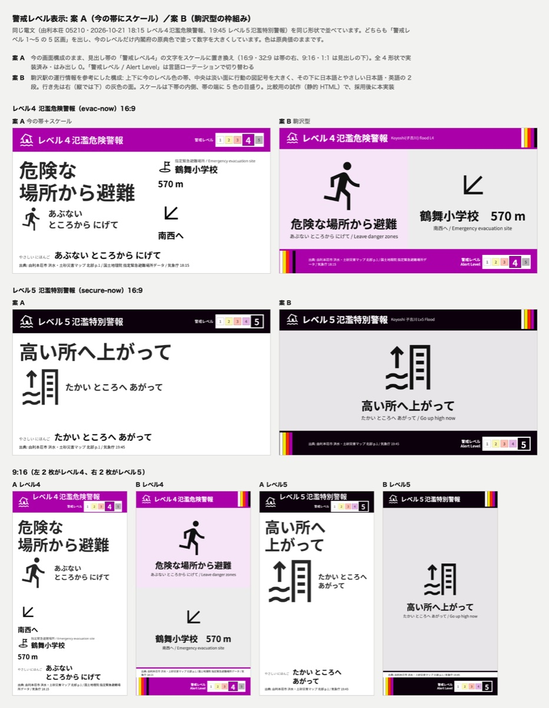
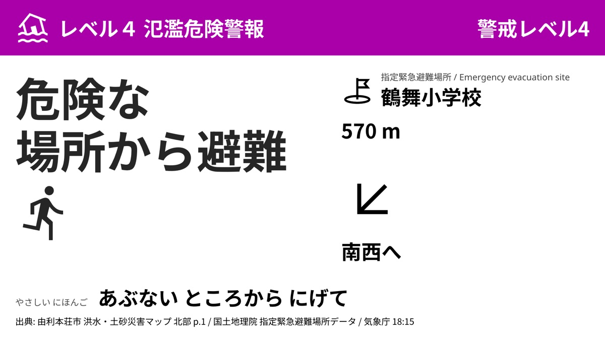
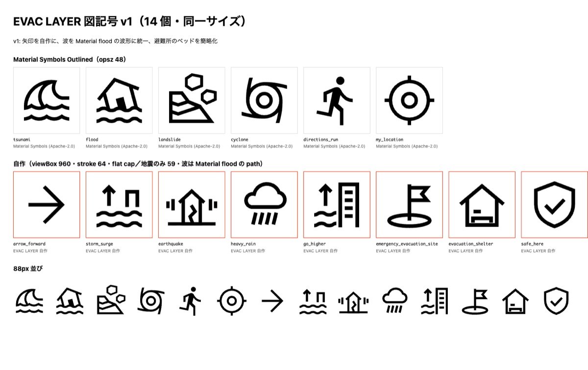
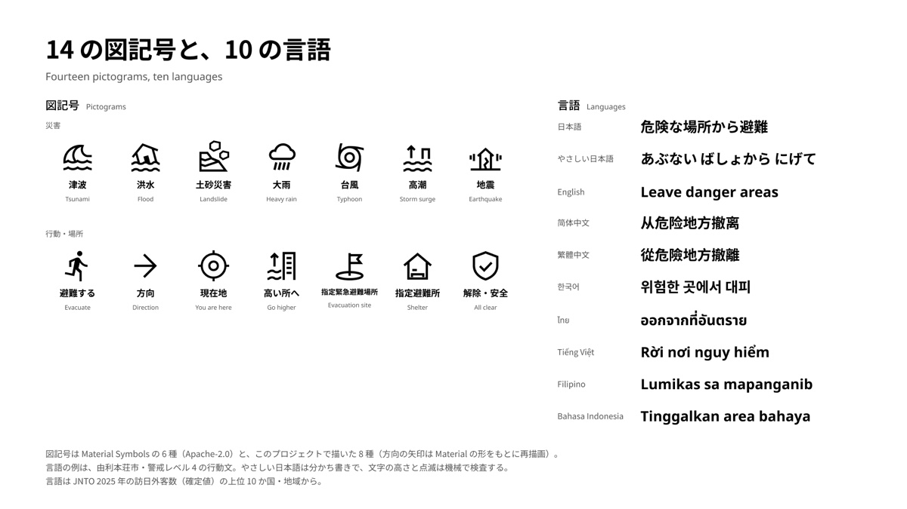
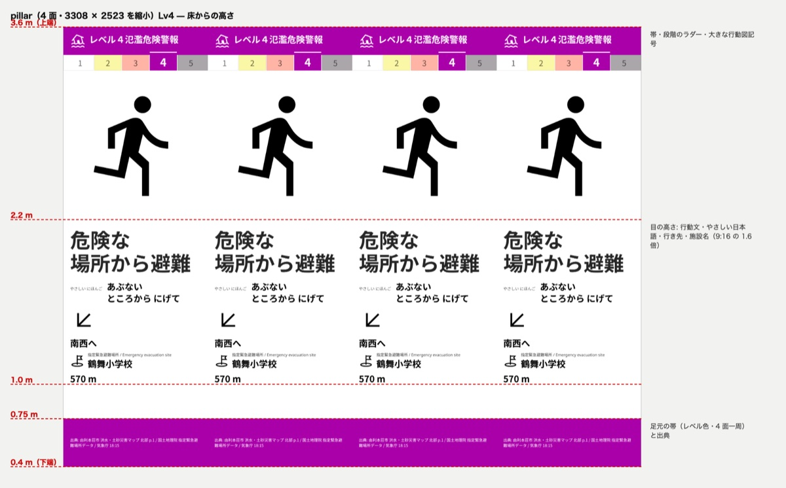
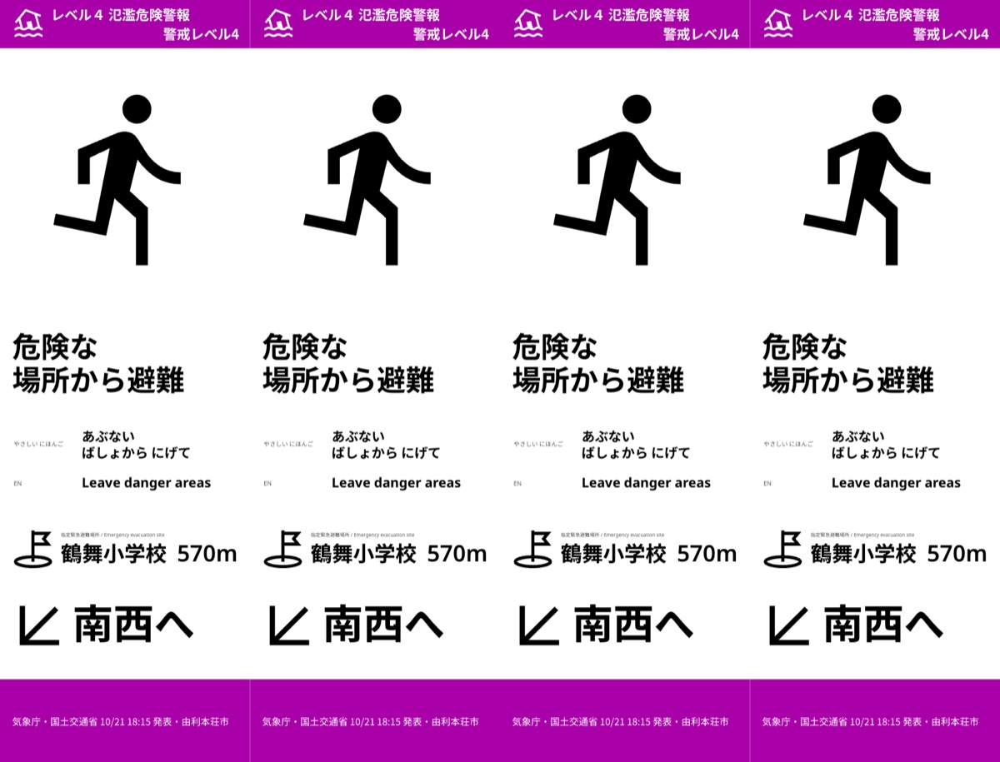
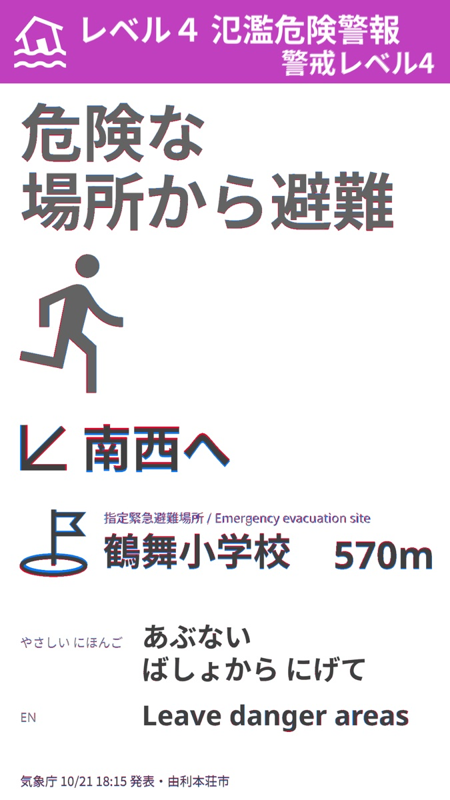
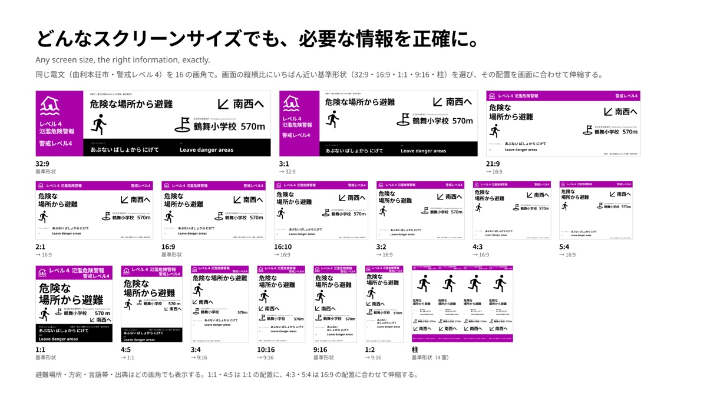
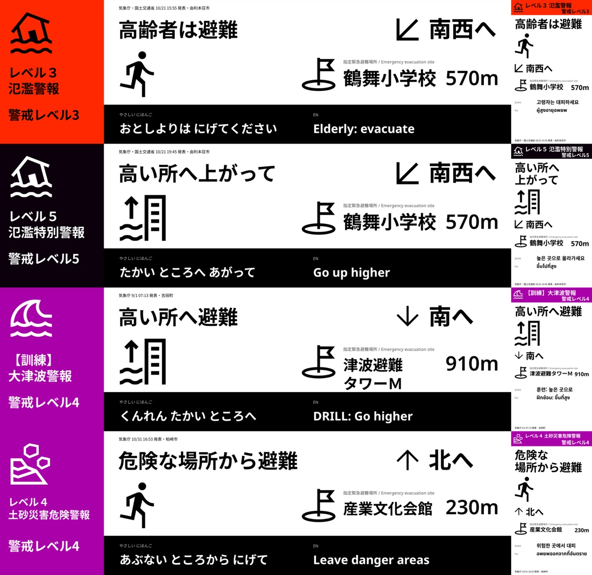

# How we built it

## Before the code / コードを書く前

The hackathon rules required the code to be written during the event, from Nov 2. From Oct 14 to Nov 1 no code was written; the time went to research and to preparing the things that only build up with time.

Five parallel Claude sessions surveyed cases in Japan and abroad, design and technology. 21 hazard-map PDFs from eight municipalities were downloaded, and whether their text could be extracted was measured. The conditions of every data source were checked; ISO 7010 pictograms may not be published online, so the screens use Material Symbols and pictograms drawn for this project instead. A launchd job began recording JMA's feeds, and by the time the hackathon started 20,592 bulletins had built up. Among them was the real sequence for the Koyoshi River in Yurihonjo, Akita, on Oct 21, rising from level 2 to 3, 4 and 5; almost every warning scene in the demo comes from those bulletins.

Alongside the code, decisions were made the same way, on evidence. The Reader's model was chosen by reading the same Wajima documents with both: Haiku cost $0.009, listed 19 facilities and no tsunami heights; Sonnet cost $0.257, listed 113 facilities and recovered the tsunami heights from a PDF that drops characters. Sonnet became the Reader, and reading all five municipalities cost $2.88 in total. Decisions were logged with times: by Nov 6, 181 of the 571 entries in the work log were decisions the author made. The day before submission, six reviews ran at once, five viewpoints (a judge, social media, branding, a developer and a critic) and the session that had been advising on branding, and their findings became the plan. "Following the README does not bring up a warning" led to measuring the approval steps again; "the screens do not say clearly enough that they are a re-creation" led to a SIMULATION mark on the images.

ハッカソンのルールで、コードは期間中（11 月 2 日から）に書くことになっていました。10 月 14 日から 11 月 1 日まではコードを書かず、調べものと、時間がたたないと溜まらないものの準備だけをしています。

国内と海外の事例、デザイン、技術は、Claude の並列のセッション 5 本で調べました。8 自治体の 21 本のハザードマップ PDF を落として、テキストが取れるかを実測し、データの利用条件も確かめています。ISO 7010 の図記号はネットに載せられないため、Material Symbols と自作の図記号に切り替えました。気象庁のフィードは launchd で自前の記録を始め、ハッカソンが始まった時点で 20,592 本の電文が溜まっていました。その中に、10 月 21 日の秋田県由利本荘市・子吉川の氾濫で、レベル 2 から 3、4、5 と上がる実際の電文の列があります。デモの警報の場面は、ほとんどがこの電文です。

コードと並行して、判断も根拠をとって進めました。Reader のモデルは、同じ輪島市の資料を読ませて比べています。Haiku は $0.009 で施設 19 件、津波の高さは取れず、Sonnet は $0.257 で施設 113 件を拾い、文字の欠けた PDF から津波の高さまで読み直しました。Reader は Sonnet にし、5 自治体を読ませた費用は合計 $2.88 です。判断は時刻つきのログに残してあり、11 月 6 日の時点で、作業の記録 571 項目のうち 181 項目が作者の判断でした。提出の前日には、審査員・SNS・ブランディング・開発者・批判役の 5 つの視点と、ブランディングを相談していたセッションの計 6 つに同時にレビューさせ、その指摘から計画を作っています。「README の手順どおりに動かしても警報が出ない」という指摘からは承認の手順を実測し直し、「再現であることの断りが足りない」という指摘からは画像に SIMULATION の印を入れました。

## Sessions

EVAC LAYER was built by one lead session and, over the week, eight implementation sessions of Claude Code, each in its own git worktree and branch, while the author watched every tab and stepped in directly when needed. Three ran from Day 1; the others were opened as the work split.

- **Lead**: writes the specs, fixes the contract between the sessions, reviews each session's work and is the only one who merges `work/*` into `main`.
- **agents** (`agents/`, `schema/`, `data/`): JMA parser, Reader, Writer, Composer, Verifier, the revision loop and the export.
- **render** (`app/`): the renderer, the live feed, the delivery API and the admin screen.
- **demo** (`demo/`): the 3D scenes, the recordings and the video.
- **layout** (`app/layout/`, from Day 3): the alert screens re-laid on the modular grid the author drew in Figma; the render session does not touch layout.
- **sim** (`sim/`): the browser simulator of the concourse.
- **brand** (Figma, `docs/brand/`, `docs/sheets/`): the wordmark, the icon and the three sheets.
- **copy** (`README.md`, `docs/`, the narration): the public wording.
- **bgm** (`demo/compose/audio/`): the background music through Suno's MCP server and the switch sound effects.

The sessions talk through cross-session messages, using one fixed shape: conclusion, files changed, how it was checked, what could not be checked, open points. A session stops and asks only when a design decision comes up, when the spec and the code disagree, when the same failure happens twice, or before a destructive step.

EVAC LAYER は、1 つのまとめ役のセッションと、週のあいだに 8 つに増えた実装のセッションで作りました。どのセッションも Claude Code で、それぞれ自分の git worktree とブランチで作業し、作者はすべてのタブを見ていて、必要なときは直接指示しました。初日から動いていたのは 3 つで、残りは作業が分かれるたびに立ち上げました。

- **まとめ役**: 仕様を書き、セッションの間の取り決めを固め、各セッションの成果を確かめ、`work/*` を `main` に取り込む唯一の役。
- **agents**（`agents/`・`schema/`・`data/`）: 気象庁の電文の parser・Reader・Writer・Composer・Verifier・書き直しのループ・書き出し。
- **render**（`app/`）: Renderer・ライブのフィード・配信の API・運営者の画面。
- **demo**（`demo/`）: 3D の場面・録画・動画。
- **layout**（`app/layout/`、3 日目から）: 警報の画面を、作者が Figma で引いたモジュールのグリッドに組み直す。render のセッションはレイアウトに触らない。
- **sim**（`sim/`）: ブラウザで動くコンコースのシミュレーター。
- **brand**（Figma・`docs/brand/`・`docs/sheets/`）: ロゴ・アイコン・3 枚の説明図。
- **copy**（`README.md`・`docs/`・ナレーション）: 公開する文章。
- **bgm**（`demo/compose/audio/`）: Suno の MCP サーバーを使った BGM と、切り替えの効果音。

セッション同士は、セッション間のメッセージでやり取りします。形は 1 つに決めてあり、結論・変更したファイル・どう確かめたか・確かめられなかったこと・未解決の点です。セッションが止まって聞くのは、設計の判断が要るとき、仕様とコードが食い違ったとき、同じ失敗が 2 回起きたとき、取り消せない操作の前だけです。

## The contract

The layout JSON is the one thing every session depends on: the Composer writes it, the renderer draws it, the Verifier checks it. It is fixed in `schema/` and summarised in the `evac-contract` skill (`.claude/skills/`). Every change goes through the lead and is announced to the sessions that read it. The renderer's DOM attributes (`data-overflow="<cell>:<lang>"` and others) are part of the same contract, so the Verifier never reaches into the renderer's internals.

layout の JSON は、すべてのセッションが頼る唯一のものです。Composer が書き、Renderer が描き、Verifier が検査します。`schema/` に固定し、`evac-contract` スキル（`.claude/skills/`）に要点をまとめてあります。変更はすべてまとめ役を通し、それを読むセッションに知らせます。Renderer の DOM の属性（`data-overflow="<cell>:<lang>"` など）も同じ取り決めの一部なので、Verifier が Renderer の中身に手を入れることはありません。

## The revision loop

Compose → verify (static schema, then the rendered page in a browser, then Vision) → send the findings back → at most three attempts. A finding goes back to whoever wrote the cell: Writer text is rewritten, while anything the code writes (the JMA headline, the shelter, the source) stops the loop with a reason instead of asking the Writer for something it cannot change. The `evac-verify` skill has the full routing.

Run over the recorded feed, this loop found 25 defects on its first Vision pass and 0 by the fifth (`docs/evaluation.md`, `agents/FINDINGS.md`).

組む → 検査する（スキーマと規則、ブラウザで描いた画面、Vision）→ 指摘を戻す、を最大 3 回。指摘は、そのセルを書いた側に戻ります。Writer の文は書き直させ、コードが書く部分（気象庁の見出し・避難先・出典）の問題は、Writer に直せないことを頼まず、理由を添えてループを止めます。振り分けの全体は `evac-verify` スキルにあります。

記録した電文でこのループを回すと、Vision の初回の検査で 25 件の欠陥が見つかり、5 回目で 0 件になりました（`docs/evaluation.md`・`agents/FINDINGS.md`）。

## Checkpoints: each session hands its context back

Every return from a session ends the same way: what it concluded, which files it changed, how it checked them, what it could not check, and what is still open. The last two lines are the checkpoint. They make the session state the context the lead cannot see (an assumption it made, a number it took from another file, a check it could not run), and the lead decides on each open point before the next step: accept, send back with the cause and the fix, or ask the author. When the copy session compared the author's subtitles with the recorded bulletins, "could not check" and "open points" were where the mismatches surfaced, such as a JMA warning written as if a city had issued it, or a recording period of three weeks described as half a month.

各セッションの返却は、いつも同じ形で終わります。結論、変更したファイル、どう確かめたか、確かめられなかったこと、未解決の点。最後の 2 つが同期の確認点です。まとめ役からは見えない文脈（置いた前提、別のファイルから持ってきた数字、走らせられなかった検査）をセッション自身に書かせ、まとめ役は次の手に進む前に、未解決の点を 1 つずつ決めます。受け入れるか、原因と直し方を添えて差し戻すか、作者に聞くか。作者の字幕を記録した電文と照らしたときも、気象庁の警報を市が発令したように書いた語や、3 週間の記録期間を半月と書いた語は、この 2 行に出てきました。

## Evals, then the fix, then a hook

The checks came first and the fixes followed them. The Verifier (schema and rules, the rendered page in a browser, then Vision) and the test suites play the part of the evals: they say which screen fails and on which check, and the session that owns the cause finds it and fixes it there. When the level-5 screens were changed to show the evacuation site too, the Verifier failed the 16:9 and 1:1 shapes on text size. The cause was not the new screens: the lower limit for text had been derived from viewing distance, while the author's Figma layouts used smaller sizes on those shapes. The limit was revised shape by shape to the Figma sizes, with the old values and the reasoning kept in `agents/FINDINGS.md`, and the six 由利本荘市 screens were run again: 6 of 6 passed. What keeps a fixed defect fixed is automatic: the PostToolUse hook validates every file a session writes, the app and agents test suites run before each merge, and a coverage run renders every screen on every shape and aspect (440 renders) and counts overflow and missing items.

検査が先にあり、直しはその後に続きました。Verifier（スキーマと規則、ブラウザで描いた画面、Vision）とテスト群が評価の役で、どの画面がどの検査で落ちたかを示し、原因を持つセッションがそれを突き止めてその場で直します。警戒レベル 5 の画面にも避難場所を出すように変えたとき、Verifier は 16:9 と 1:1 を文字の大きさで落としました。原因は新しい画面ではなく、文字の下限を視距離から導いていた一方で、作者が Figma で組んだレイアウトはその形でもっと小さい文字を使っていたことでした。下限を形ごとに Figma の実寸へ改め、旧値と理由を `agents/FINDINGS.md` に残してから、由利本荘市の 6 画面を回し直すと 6 画面とも通りました。直した欠陥が戻らないようにする仕組みは自動です。PostToolUse フックがセッションの書いたファイルを毎回検証し、統合の前に app と agents のテストが走り、全画面を全形状・全画角で描く確認（440 枚）が溢れと欠けを数えます。

## Fresh-context review

Before submission, a new Claude session (Opus) with none of the builders' context played the judge. It scored the submission against the organisers' four judging criteria and their weights, and returned the risks of disqualification, the weaknesses ranked HIGH / MEDIUM / LOW with a fix for each, and whether each fix could land before the deadline. The point was not the score: it was to learn whether a reader with no prior knowledge understands the project correctly, and whether the README's claims match the code. The findings that could be fixed were fixed before the next reading, and the last pass used three readers, one reading the whole repository, one reading only the README, one reading only the English, which led to `MAP.md`, a map of what is where. The core finding of the first run was that approval was bound to the bulletin ID, so a real new bulletin was always unapproved the moment it arrived; the claim that what a person approved in advance goes out automatically at the moment of the alert did not match the code. Approval was rebound to the kind of screen: facility × hazard × template × level (README, "何を出すかは、事前に人が決める"; `agents/FINDINGS.md`, "承認の単位"). The run on Nov 8 found that on a device without WebGL the ambient scene threw an exception and the alert screen did not appear either; the ambient layer now falls back to a still screen (the end of `agents/FINDINGS.md`).

The other reviews were kept apart from the authors in the same way. A model from another company, OpenAI's Codex, reviewed the diffs: 11 findings on the approval model, 9 adopted, and 11 on municipality codes and the 100 m facility lookup, 10 adopted. The ten-language text was back-translated by another model that never saw the source, and compared with it (`agents/FINDINGS.md`, item 9). Removing comments was given to a separate session that did nothing else, so the author of the code was not the one defending its comments.

提出の前に、作り手の文脈を持たない新しいセッションの Claude（Opus）を審査員役にしました。主催の 4 つの審査基準と配点で採点させ、失格のリスク、HIGH / MEDIUM / LOW の弱点とそれぞれの直し方、締め切りまでに直せるかを返させています。目的は点数ではなく、事前の知識が無い読み手がこのプロジェクトを正しく理解できるか、README の主張とコードが一致しているかを確かめることです。直せる指摘は次の読み手に回す前に直し、最後はリポジトリ全体・README だけ・英語だけの 3 通りの読み手で読ませて、何がどこにあるかの地図 `MAP.md` を置きました。1 回目の核心の指摘は、承認が電文 ID に束縛されていて、本物の新しい電文は届いた瞬間に必ず未承認になる、というものでした。「事前に人が承認したものが、警報の瞬間に自動で出る」という主張と実装が食い違っていたので、承認を画面の種類（施設 × 災害 × テンプレート × レベル）に束ね直しました（README「何を出すかは、事前に人が決める」・`agents/FINDINGS.md`「承認の単位」）。8 日の採点では、WebGL の無い端末で平常時の演出が例外を投げ、警報の画面も出ないことが見つかり、静止画面に落とす受け皿を作りました（`agents/FINDINGS.md` の末尾）。

ほかのレビューも、同じように作り手から切り離しています。別の会社のモデル（OpenAI の Codex）に差分をレビューさせ、承認のモデルで 11 件（採用 9 件）、市町村コードと 100 m の施設の解決で 11 件（採用 10 件）の指摘を反映しました。10 言語の文は、原文を見せない別のモデルに逆翻訳させて照合しました（`agents/FINDINGS.md` の 9）。コメントを消すのは、それだけをする別のセッションに任せ、コードを書いた本人がコメントを擁護しないようにしました。

## Before and after / 試行錯誤の跡

Four places where the first version was replaced, each with the screen before and after.

ほかの案に置き換えた 4 か所を、前と後の画面で並べます。

| Before / 前 | After / 後 |
|---|---|
|  |  |
|  |  |
|  |  |
|  |  |

1. **The alert level.** On Nov 2 the level was drawn as a five-step scale: five boxes in the corner of the band, or a layout modelled on a station's service information. Both were dropped and the band went back to a single label, 警戒レベル4. The author chose to take something away rather than add.
2. **The pictograms.** ISO 7010 pictograms may not be published online, so the first set was six Material Symbols and eight drawn here. The first Vision pass found 25 findings where the action pictogram contradicted the screen; after the rule that the action pictogram shows the action only, the findings went 25 → 8 → 4 → 4 → 0 (`agents/FINDINGS.md`).
3. **The pillar.** The LED column was divided by height from the floor: the band at the top up to 3.6 m, the action text, direction and shelter at eye height between 2.2 m and 1.0 m, and a band at the feet between 0.75 m and 0.4 m with the sources. The final screen keeps the band at the top and the sources at the feet, and drops the level boxes, as in 1.
4. **The layout.** The layout first derived by rules from the grid was set aside. The author laid out 9:16 in Figma, and the renderer reproduces it: all 16 measured elements fall within 4 px of the artboard (`app/layout/GRID.md` §8). The other shapes followed the same hierarchy, and every aspect ratio takes the nearest shape. The author draws the layout; the system carries it to every screen.

1. **警戒レベルの見せ方。** 11 月 2 日は、レベルを 5 段の目盛りで見せる案を 2 つ作りました。帯の隅に 5 つの箱を置く案と、駅の運行情報を参考にした構成です。どちらもやめ、帯の「警戒レベル4」のラベルに戻しました。足すより外す判断を、作者がしました。
2. **図記号。** ISO 7010 の図記号はネットに載せられないため、最初の組は Material Symbols の 6 個と、このプロジェクトで描いた 8 個でした。Vision の初回の検査では、行動の図記号が画面の内容と矛盾する 25 件が見つかりました。「行動の図記号は行動だけを表す」と決めてからは、指摘が 25 → 8 → 4 → 4 → 0 になりました（`agents/FINDINGS.md`）。
3. **柱の LED。** 床からの高さで情報を振り分けました。3.6 m までの上端に帯、目の高さの 2.2〜1.0 m に行動の文・行き先・避難先、足元の 0.75〜0.4 m に出典の帯です。最終の画面も上端の帯と足元の出典を保ち、1 と同じくレベルの箱を外しました。
4. **レイアウト。** グリッドから規則で導いた最初の配置はやめました。作者が Figma で 9:16 を組み直し、Renderer はそれを再現しています。測った 16 の要素は、すべて Figma の画面と 4 px 以内で揃います（`app/layout/GRID.md` の §8）。ほかの形状も同じ組み方に従い、どの画角も近い形状の配置で描きます。組むのは作者で、すべての画面に広げるのはシステムです。

The same 32:9 and 9:16 layouts carry four different alerts from three municipalities: a flood at level 3 and level 5, a drill major tsunami warning at level 4, and a landslide warning at level 4.

同じ 32:9 と 9:16 の配置で、3 つの自治体の 4 つの警報を描いたものです。洪水のレベル 3 とレベル 5、訓練の大津波警報（レベル 4）、土砂災害のレベル 4 です。

## Built for next year's model

The parts that decide what a screen may say are fixed outside the model: the layout, alert, municipality and feed schemas in `schema/`, the renderer's DOM attributes that the Verifier reads, and the approval gate (`/api/live-layout` serves a layout only at a site with automatic delivery switched on, and only for an approved bulletin or for a new bulletin of an approved kind of screen whose own browser check passed; approvals live in `data/approvals.json`, and the only parts a person has not seen are the JMA warning name and the issue time). The Reader, the Writer and the Vision Verifier sit inside that frame. A newer model can replace any of them, write better text or catch more defects, and the screens still have the same cells, the same checks and the same rule that nothing reaches a screen without a person's approval. The Reader was chosen this way during the week: Haiku and Sonnet were run on the same 輪島市 documents and compared on the same output schema (`agents/README.md`).

画面に何を出してよいかを決める部分は、モデルの外に固定してあります。`schema/` の layout・alert・municipality・feed のスキーマ、検査役が読む描画側の DOM 属性、承認ゲート（`/api/live-layout` は、自動配信を入れたサイトで、承認済みの電文か、承認済みの種類の画面でブラウザの検査を通った新しい電文にだけレイアウトを返す。承認の記録は `data/approvals.json`。人が見ていないのは気象庁の警報名と発表時刻だけ）。資料を読む役、文章を書く役、画面を見て検査する役は、その枠の中にいます。新しいモデルに入れ替えて、文章が良くなっても検査で拾える欠陥が増えても、画面のセルも、検査の規則も、人が承認したものしか画面に出ないという決まりも変わりません。今回も資料を読む役のモデルは、同じ輪島市の資料を Haiku と Sonnet で読ませ、同じ出力のスキーマの上で比べて選びました（`agents/README.md`）。

## Claude in the pipeline

- **Reader**: Sonnet 5.5 turns municipal hazard-map PDFs into knowledge files, with citations and structured outputs. When a PDF's text layer drops characters, it reads the page images instead.
- **Writer**: Opus 5.5 writes the action text in ten languages within per-shape character budgets. Its output passes rule checks and is cached so that the same alert gives the same screen.
- **Verifier (Vision)**: Sonnet 5.5 compares each rendered shape with its bulletin.

- **Reader**: Sonnet 5.5 が、自治体のハザードマップ PDF を、出典と構造化した出力つきの知識ファイルにします。PDF のテキストから文字が抜けているときは、ページを画像として読み直します。
- **Writer**: Opus 5.5 が、形状ごとの文字数の上限の中で、行動の文を 10 の言語で書きます。出力は検査規則を通り、同じ警報から同じ画面が出るように記録しておきます。
- **Verifier（Vision）**: Sonnet 5.5 が、描いた画面を形状ごとに電文と照らします。

## Claude Code features

- **Skills**: `evac-fanout`, `evac-verify` and `evac-contract` in `.claude/skills/`.
- **Subagents**: used for parallel research, for example one subagent per municipality when surveying hazard-map PDFs.
- **Hooks**: a PostToolUse hook (`.claude/settings.json`, `.claude/hooks/check-data.sh`) runs on every Write and Edit. It validates layouts, municipality files and fixtures against `schema/` and checks Writer records against the writing rules, and a violation goes straight back to the session that wrote the file. Files outside those paths are not touched, so the other sessions are unaffected. Changing project settings is not something a session may do by itself, so the author installed the hook after reviewing the draft.
- **MCP**: none in the product. The Reader, Writer and Vision Verifier call the Claude API through `@anthropic-ai/sdk`, and the Verifier's browser check drives Chrome with `puppeteer-core`, so the pipeline runs headless with no MCP server in the loop. During development the `bgm` session made the background music through Suno's MCP server, and the lead session used the Claude in Chrome extension (an MCP server into the author's own browser) once, to search Pinterest for signage references before deciding how to show the alert level; that design was later dropped. The images of the captions and on-screen text laid over the video were exported from Figma through Figma's MCP server (`demo/compose/overlays.md`). `blender-mcp` was weighed for the 3D scenes and rejected in favour of plain `bpy` scripts, so the scene is reproducible from the repository (`demo/APPROACH.md`). Traffic between the sessions is Claude Code's cross-session messaging, not MCP.

- **スキル**: `.claude/skills/` の `evac-fanout`・`evac-verify`・`evac-contract`。
- **サブエージェント**: 並行の調査に使いました。たとえばハザードマップ PDF を調べるときは、自治体ごとに 1 つずつ。
- **フック**: PostToolUse のフック（`.claude/settings.json`・`.claude/hooks/check-data.sh`）が、Write と Edit のたびに走ります。レイアウト・自治体のファイル・テスト用のデータを `schema/` で検証し、Writer の記録を文章の規則で検査し、違反はそのファイルを書いたセッションにすぐ戻ります。対象外のパスのファイルには触れないので、ほかのセッションには影響しません。プロジェクトの設定はセッションが自分で変えてよいものではないので、作者が下書きを確かめてからフックを入れました。
- **MCP**: 製品には使っていません。Reader・Writer・Vision の Verifier は `@anthropic-ai/sdk` で Claude の API を呼び、Verifier のブラウザの検査は `puppeteer-core` で Chrome を動かすので、パイプラインは MCP サーバーを挟まず、画面なしで動きます。開発中は、`bgm` のセッションが Suno の MCP サーバーで BGM を作り、まとめ役のセッションが Claude in Chrome の拡張（作者のブラウザにつながる MCP サーバー）を 1 回だけ使い、警戒レベルの見せ方を決める前に Pinterest でサイネージの参考を探しました。その案は後に取り下げました。動画に重ねる字幕・テロップの画像は、Figma の MCP サーバーで Figma から書き出しました（`demo/compose/overlays.md`）。3D の場面には `blender-mcp` も検討しましたが、リポジトリから場面を作り直せるよう、素の `bpy` のスクリプトにしました（`demo/APPROACH.md`）。セッションの間のやり取りは Claude Code のセッション間のメッセージで、MCP ではありません。
